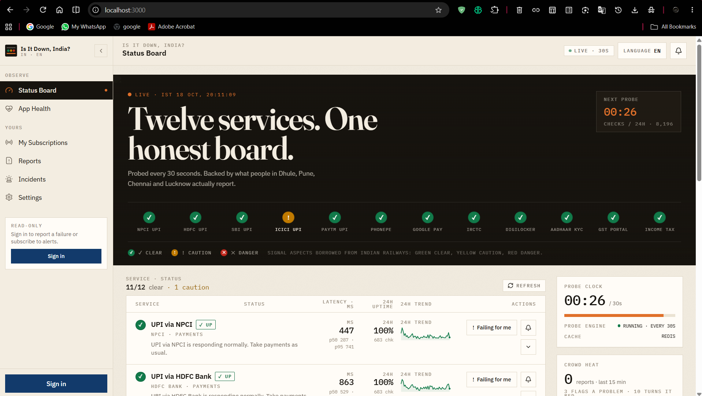
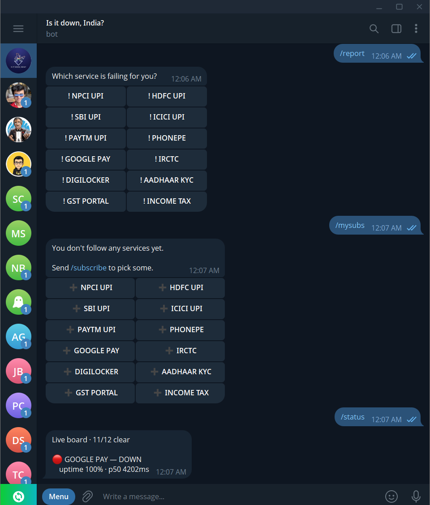
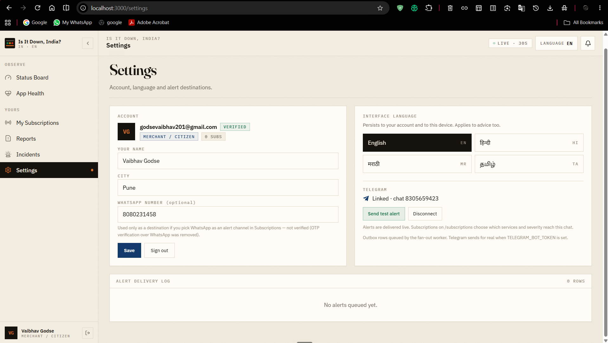
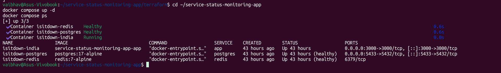
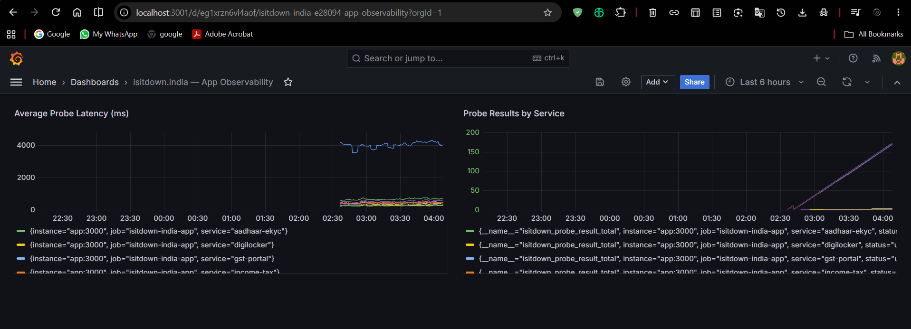
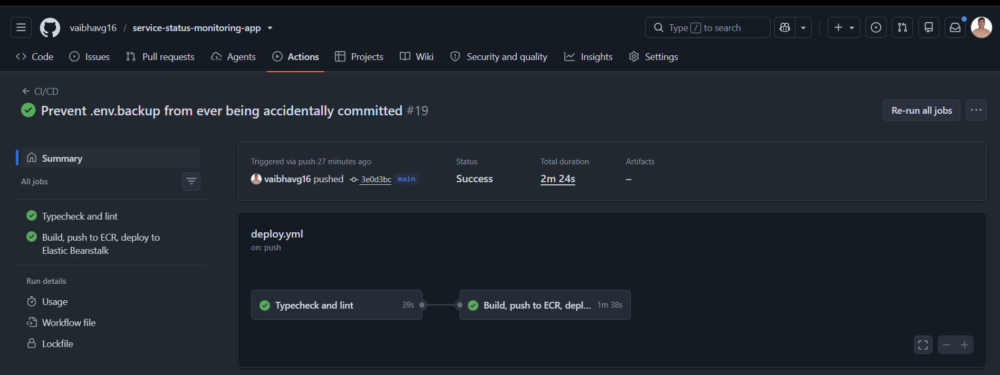
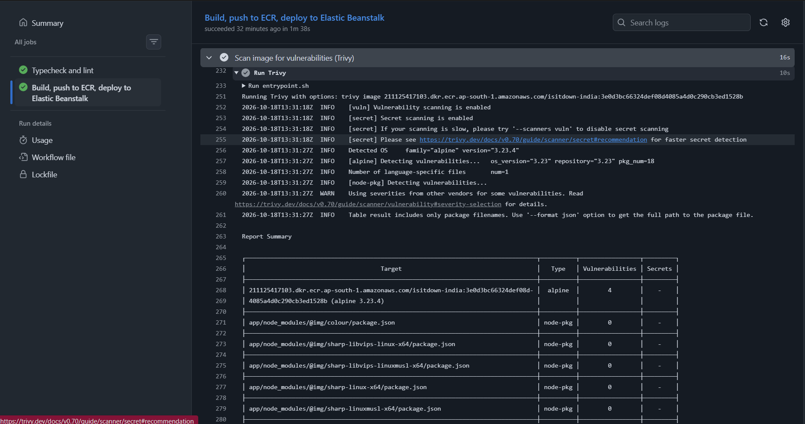
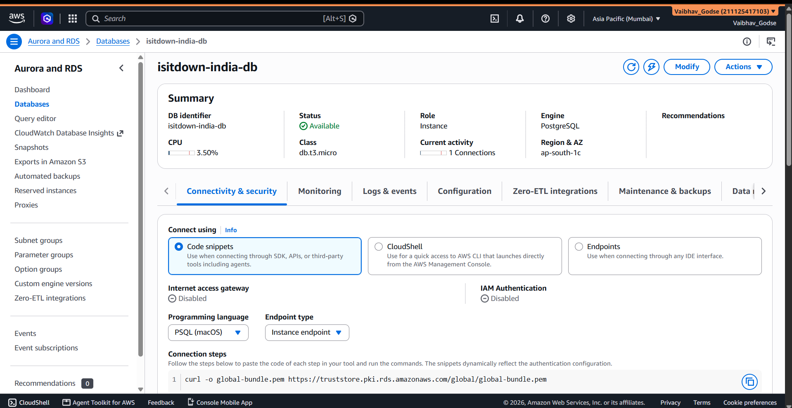
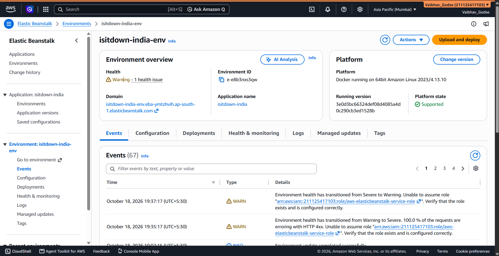
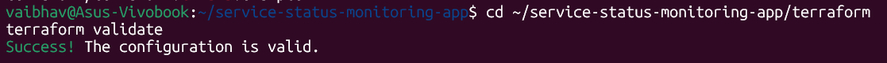

# isitdown.india

A status-monitoring tool for Indian digital infrastructure — UPI, Aadhaar eKYC, DigiLocker, the GST portal, the Income Tax e-filing site, and a few others. Built it because most uptime tools are either paid SaaS or a pain to self-host, and I wanted something free that I actually control end to end.

It checks these services on a schedule, logs what it finds, and pings subscribers on Telegram or email if something goes down. No paid vendor lock-in anywhere in the stack.

---

## Tech stack

| Layer | Tech | Why |
|---|---|---|
| App | Next.js (App Router), TypeScript | one codebase for UI + API |
| DB | PostgreSQL, Drizzle ORM | typed queries, migrations I can actually read |
| Cache | Redis | falls back to an in-process LRU if Redis isn't up, so it doesn't just die |
| Auth | Email OTP via Resend | no passwords to manage or leak |
| Alerts | Telegram Bot API, Resend email | push-style notifications, free |
| Probing | custom scheduler (`probe.ts`) | checks each service, records latency + status |
| Metrics | Prometheus + Grafana (`prom-client`) | so I can see how the monitor itself is performing, not just the services it watches |
| Containers | Docker (multi-stage build), Docker Compose | app + Postgres + Redis + Prometheus + Grafana, one command |
| CI/CD | GitHub Actions | lint/typecheck → build → Trivy scan → push to ECR → deploy |
| IaC | Terraform | spins up / tears down the whole AWS side on demand |
| Cloud | AWS — RDS, Elastic Beanstalk, ECR, IAM | |
| Tests | Vitest | 180 passing right now |

Roughly how a request moves through the system: someone hits the status board, sees live health for each service. In the background a probe cycle is running every so often, checking each service, writing the result to Postgres, and also pushing it into Prometheus through `/api/metrics`. If a service flips from up to down, anyone subscribed gets pinged on Telegram and/or email. Users log in with just an email OTP — no password — and can optionally link Telegram for faster alerts. Grafana sits on top of Prometheus so I can watch probe latency and failure counts over time, which has already been useful for catching slow services before they fully go down.

On the ops side: every push to `main` runs through GitHub Actions — typecheck, lint, Docker build, a Trivy scan, push to ECR, deploy to Elastic Beanstalk. All of the AWS infrastructure behind that (database, hosting, IAM roles, container registry) is defined in Terraform, so I can bring the whole environment up for a demo and tear it down right after instead of paying for it to sit idle.

### Architecture diagram

*How everything connects — users and Telegram at the top, the app in the middle, data/external services and observability on either side, and the CI/CD + Terraform pipeline underneath that actually ships and hosts it.*

---

## App architecture

- Next.js App Router for both the frontend and the API routes
- Postgres via Drizzle ORM
- Redis for ephemeral state, with a fallback so it doesn't hard-fail if Redis is down
- Email OTP login through Resend
- Telegram bot for both verifying your account and sending alerts

One thing worth mentioning: I originally built WhatsApp OTP too, using the Cloud API. Ripped it out later after hitting repeated sandbox account lockouts from Meta that made it unreliable for anything beyond a demo. Telegram ended up being the better call — free, stable, and the bot API doesn't require business verification.

*Status board — 12 services, live.*

*Bot responding to `/report`, `/mysubs`, `/status`.*

*Settings page showing the linked Telegram account.*

---

## Containerization

Standard multi-stage Dockerfile: `deps` installs packages, `builder` runs `next build`, `runner` copies over just the compiled output and runs as a non-root user. Keeps the final image small. Tested with real `docker build` + `docker run`, hitting an actual database, not just a smoke test.

---

## Docker Compose setup

`docker-compose.yml` runs everything together: the app, Postgres (on port 5433 so it doesn't clash with anything already running locally), Redis, and now Prometheus + Grafana too. They all talk to each other by service name through Compose's built-in DNS.

*All containers healthy.*

I also tried an Elasticsearch/Kibana/Filebeat log pipeline in a sandbox compose file at one point, to see if shipping logs somewhere searchable was worth the overhead. It worked, but I left it out of the main compose file on purpose — didn't want to make anyone running this locally spin up three extra JVM-heavy containers just to see logs. For now `docker compose logs` is enough; the ELK stack is a "later" item, not a "pretend it's there" item.

---

## Observability — Prometheus + Grafana

This part is actually running, not just sketched out.

- `/api/metrics` exposes Prometheus-format metrics:
  - `isitdown_probe_result_total{service, status}` — count of every probe, by service and outcome
  - `isitdown_probe_duration_ms{service}` — how long each probe took
  - plus the default Node process metrics (memory, CPU, event loop lag) from `prom-client`
- Prometheus scrapes that endpoint every 15 seconds
- Grafana reads from Prometheus and shows two panels: latency per service, and result counts per service over time

*Live dashboard, pulling real data from the running app.*

Both run as extra services in the same `docker-compose.yml`, so `docker compose up -d --build` brings up the dashboards along with everything else. Figured if I'm building a tool that watches whether other people's services are healthy, mine should be able to tell me the same thing about itself.

---

## CI/CD — GitHub Actions

`.github/workflows/deploy.yml`, runs on every push to `main`:

1. Typecheck + lint
2. If that passes: build the Docker image, run a Trivy scan on it, push to ECR (tagged with the commit SHA so I always know what's actually deployed), deploy to Elastic Beanstalk

Two things that actually broke along the way, worth noting:

The pipeline originally had an `npm test` step that failed outright because there was no test framework wired up yet. Instead of faking a passing test, I just changed the gate to typecheck + lint for now and left adding real Vitest coverage as a to-do, rather than hide it.

Separately, Beanstalk's deploy step kept getting flagged as failed because the environment shows a "Severe" health color for about a minute after every deploy while the instance re-registers — even though the app is already serving traffic fine by then. Took a bit to realize the color was lagging behind reality; checked the actual health endpoint directly instead of trusting Beanstalk's status color, and made that specific transient state non-blocking.

---

## AWS deployment

| Service | What it's for |
|---|---|
| IAM | scoped user for GitHub Actions, only ECR + Beanstalk permissions |
| ECR | private image registry |
| RDS (Postgres 17) | production DB |
| Elastic Beanstalk | runs the container, handles the public endpoint and health checks |

Kept it to a single-instance Beanstalk environment to avoid load balancer costs. RDS's security group only allows two things in: my own IP (for migrations) and the Beanstalk instance's security group (for the app itself) — not open to the internet.

Note on judging: the hackathon rules don't require a live link, so AWS resources here get spun up on demand for demos and torn down right after to keep costs down. The screenshots above are from an actual deployment though, not a mockup.

### Bugs I actually hit (and fixed) deploying this

1. **`ECONNREFUSED 127.0.0.1:5432`** — deployed app was still pointing at a local dev `DATABASE_URL`. Turned out an env var edit in the AWS console hadn't actually saved. Re-entered it properly and it was fine.
2. **`ETIMEDOUT` connecting to RDS** — my home IP had changed since I set up the security group rule. Classic home-ISP problem. Fixed by checking `curl -4 ifconfig.me` and updating the rule. This happened again a second time later, so now it's just a standard first step before touching Terraform at all.
3. **`no pg_hba.conf entry ... no encryption`** — RDS wants SSL and my connection string wasn't asking for it. Added `?sslmode=no-verify`. Not the most rigorous fix — a real production setup should pin RDS's CA cert instead — but good enough for now, and I've said so here rather than pretend it's fully hardened.
4. **IAM "Unable to assume role"** — the Beanstalk service role lived under IAM path `/service-role/`, which gives it a different ARN than Beanstalk was expecting when resolving by name alone. Compared the actual ARN against what Beanstalk was trying to assume, then referenced the full path explicitly. Took a while to track down.

### The Telegram bug that actually took the longest to find

"Connect Telegram" looked completely broken — you'd hit START on the bot and it would just say "not linked," every time, even with a token that was correctly signed and not expired. Spent a while checking webhook reachability, signature verification, token expiry — all fine. Turned out the real issue wasn't in my code at all: Telegram's own `/start` deep-link spec only allows `A-Z a-z 0-9 _ -` and caps the parameter at 64 characters. My token had dots in it as separators, and Telegram was silently stripping them before the bot even received the message. Switched the token format to fixed-width hex with a truncated HMAC — 39 characters, all legal, still properly signed — and added round-trip/tamper/expiry tests before shipping it again. Good reminder that not every bug is yours; sometimes it's an undocumented limit in someone else's API.

---

## Infrastructure as Code — Terraform

Mirrors the whole AWS setup: IAM roles/policies, an ECR repo reference (shared with CI, not recreated), the RDS instance and its security group, and the Beanstalk app/environment with the `DATABASE_URL` computed automatically from RDS's own output so it can't drift out of sync.

This isn't just `terraform validate` passing — I've actually run `terraform apply` against a real AWS account from a clean slate and had it come up correctly. There's a `resume.sh` / `start.sh` script that does the whole sequence: apply, grab the new `DATABASE_URL` from Terraform's output, push the schema, seed data, and kick off a real deploy through the CI pipeline. A matching `stop.sh` tears it all back down.

---

## What's next

- Real Vitest coverage in CI, not just typecheck/lint
- HTTPS in front of Beanstalk (needed for Telegram webhooks to work on the live URL)
- Actually ship the ELK log pipeline once this moves past demo scale
- Alerting rules in Grafana (e.g. flag sustained high latency, not just full outages)
- Import the existing AWS resources into Terraform properly instead of having them exist outside it
- Google sign-in as a second login option
- Maybe Kubernetes, if this ever needs to scale past a single instance

---

## What I learned building this

The honest version: most of the real work here wasn't writing the app logic, it was the gap between "works on my machine" and "works in production." A bad env var and a network problem can look identical until you actually read the logs. A blocked security group looks the same as a wrong password until you isolate each layer and test it on its own.

I got a lot more comfortable with AWS networking by just hitting walls — a stale IP allowlist, a missing ECR permission, an SSL requirement I didn't know existed until RDS told me about it, an IAM role that quietly behaves differently depending on its path. None of that is obvious until you've broken it once.

The Telegram bug was a good reminder that sometimes the bug isn't yours — it's an assumption you made about someone else's API that turns out to be wrong, and the only way to find it is to go read their actual docs instead of guessing.

I also ended up caring more about honesty in the writeup than I expected to going in. It was tempting to just say "ELK is set up" because I'd gotten it working once in a sandbox, but it's not in the shipped compose file, so I said that instead. Same with Terraform — there's a real difference between "validates" and "actually applied," and I wanted this README to reflect which one is true for each part.

If there's a single takeaway: automated pipelines and IaC aren't extra polish, they're what make a project something you can hand to someone else (or come back to yourself in six months) and actually trust. That, plus making a monitoring tool that bothers to monitor itself, is the part I'm most glad I did.
